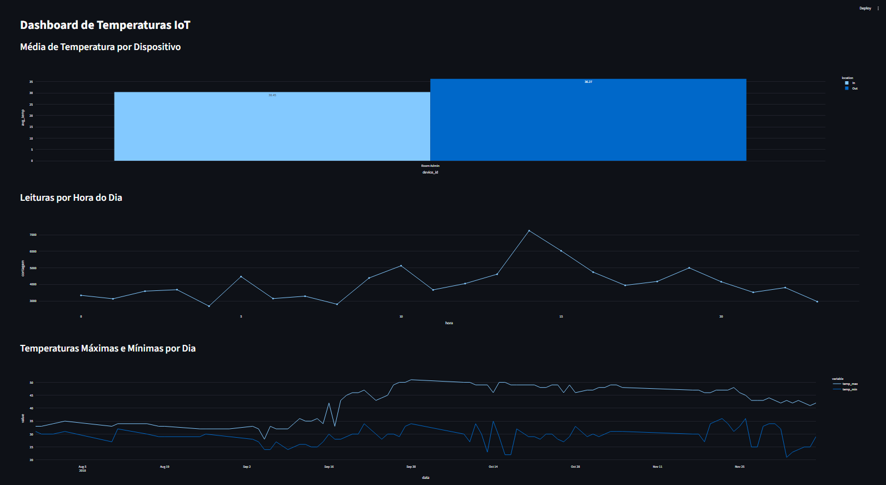
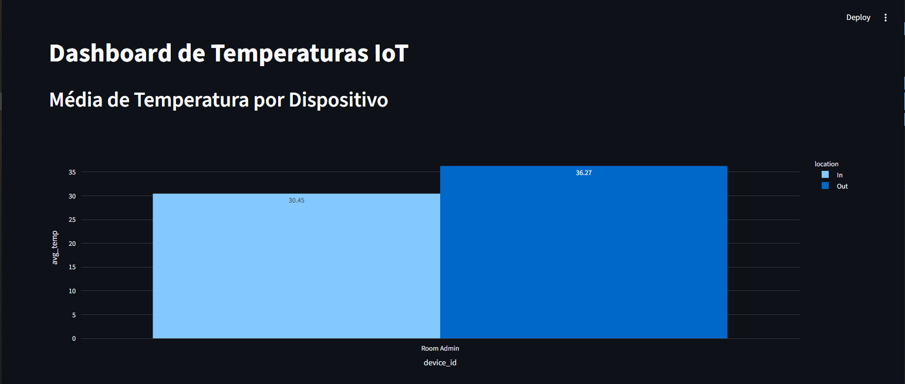
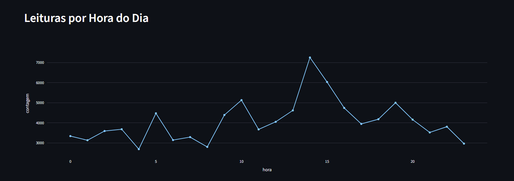
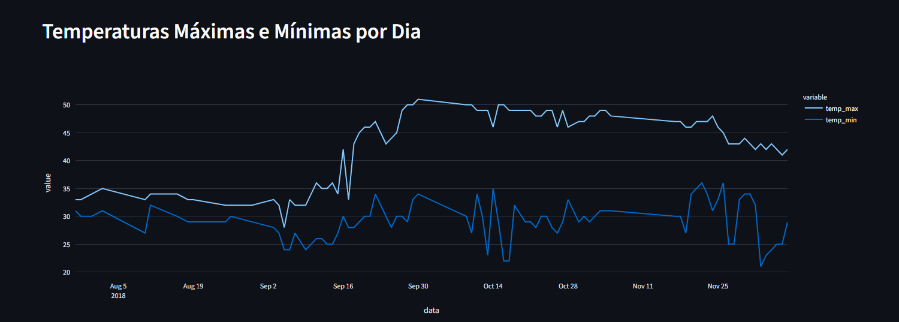
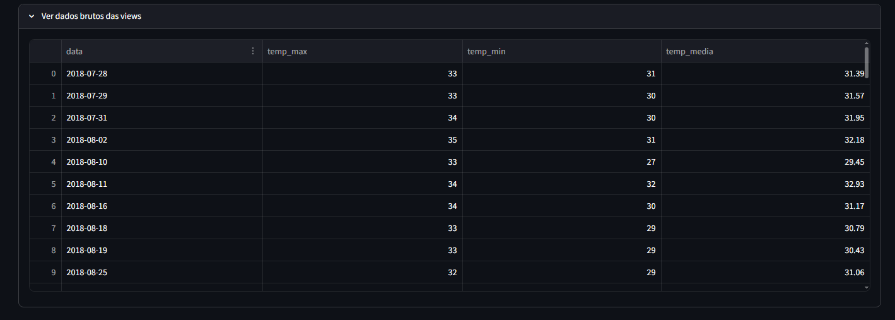

## Dataset

O arquivo `IOT-temp.csv` já está em `data/`. Colunas: `id`, `room_id/id`, `noted_date`, `temp`, `out/in`. São 97.606 leituras, de 28/07/2018 a dezembro/2018. Após a limpeza (remoção de duplicados) restam 97.605 linhas.

## Como executar

**Pré-requisitos:** Git, Python 3, Docker com Docker Compose.

```bash
# 1. Clonar
git clone git@github.com:Dieggo775/iot-pipeline.git
cd iot-pipeline

# 2. Ambiente virtual e dependências
python3 -m venv .venv
source .venv/bin/activate
pip install -r requirements.txt

# 3. Variáveis de ambiente (edite a senha no .env)
cp .env.example .env

# 4. Subir o PostgreSQL
docker compose up -d
docker exec postgres-iot pg_isready -U iot_user -d iot_db   # aguarde "accepting connections"

# 5. Carregar os dados e criar as views
python src/ingest.py

# 6. Rodar o dashboard
streamlit run src/dashboard.py --server.address 0.0.0.0 --server.port 8501
```

Acesse `http://localhost:8501` (ou `http://IP_DO_SERVIDOR:8501`).

> **Porta do banco:** o projeto usa a **5433** no host, porque a 5432 estava ocupada por outro container. Se a sua estiver livre, altere `POSTGRES_PORT` no `.env`.

## Views SQL

| View | Propósito |
|---|---|
| `avg_temp_por_dispositivo` | Média de temperatura e total de leituras por dispositivo e local (interno/externo). Permite comparar os ambientes. |
| `leituras_por_hora` | Quantidade de leituras por hora do dia. Mostra a distribuição da coleta e ajuda a identificar horários com menos dados. |
| `temp_max_min_por_dia` | Temperatura máxima, mínima e média por dia. Mostra a evolução no tempo e dias de maior variação. |

O código está em [`sql/views.sql`](sql/views.sql).

## Dashboard



**Média de temperatura por dispositivo (interno × externo)**


**Leituras por hora do dia**


**Temperaturas máximas e mínimas por dia**


**Dados brutos da view**


## Insights

1. **Interno × externo:** o sensor externo (`Out`) registra média de 36,27 °C contra 30,45 °C do interno (`In`), diferença de cerca de 5,8 °C. O `Out` concentra 79% das leituras (77.260 de 97.605).
2. **Mudança de padrão em meados de setembro:** até o início de setembro, as máximas diárias ficavam entre 32 e 35 °C. Por volta de 16/09 elas saltam para 42–45 °C e chegam a cerca de 51 °C no fim do mês, mantendo-se entre 46 e 50 °C em outubro e novembro, com queda em dezembro. As mínimas ficam mais instáveis. A causa não é determinável pelos dados (sazonalidade, calibração, mudança de instalação ou fonte de calor são hipóteses a investigar).
3. **Coleta irregular ao longo do dia:** o pico de leituras é às 14h (7.248) e o menor volume às 4h (2.690), cerca de 2,7 vezes menos.
4. **Lacunas de coleta:** há dias sem nenhuma leitura (por exemplo 30/07, 01/08 e 03 a 09/08), indicando possível indisponibilidade do sensor.

**Uso prático:** alertas de temperatura acima de um limiar, detecção de sensores sem comunicação, manutenção preditiva pela tendência das máximas e análise de eficiência de climatização.

## Comandos Git utilizados

```bash
git config --global user.name "Dieggo775"
git config --global user.email "dieggo_taylor@hotmail.com"
git init
git remote add origin git@github.com:Dieggo775/iot-pipeline.git
git add .
git commit -m "feat: pipeline IoT com Docker, PostgreSQL e ingestão"
git branch -M main
git push -u origin main
git pull
```
EOF